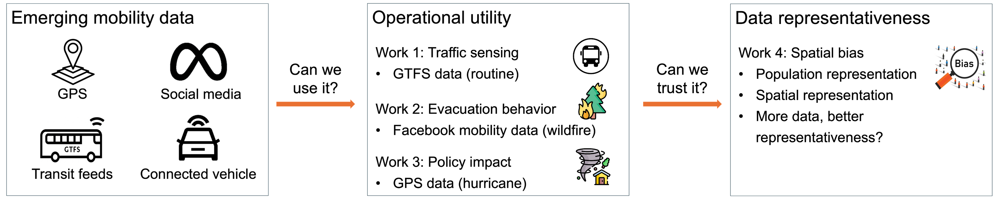

# Mobility research portfolio — Shangkun Jiang

[Google Scholar](https://scholar.google.com/citations?user=s4rHF3MAAAAJ&hl=en) · [Personal website](https://skjiang07.github.io/?v=20260919-2)

I study how mobility data can support transportation monitoring, evacuation analysis, data-quality assessment, and travel behavior inference. Explore **original research figures, papers, and selected code** across five projects.



*My dissertation connects the operational utility of emerging mobility data with the question of whether those data represent the populations and places being studied. GeoAI-Act extends this portfolio to stay detection and activity-purpose inference.*

I carried out the hands-on work in these projects end to end, including data preparation, methodology and software development, analysis, validation, visualization, and manuscript preparation. Publications retain their coauthor credits. Each project explains my contribution, its code provenance, and the limits of the public sample.

## Explore the projects

| Project | Research status | What to explore |
| --- | --- | --- |
| [GTFS traffic monitoring](projects/gtfs-traffic-monitoring/) | Transportation Research Record, 2025 | Method framework, traffic validation figures, published paper, and original GIS/travel-time notebooks |
| [Hurricane Ian traffic impacts](projects/hurricane-ian-traffic/) | International Journal of Disaster Risk Reduction, 2026 | Statistical design, evacuation-order results, published paper, and model illustration |
| [Wildfire evacuation](projects/wildfire-evacuation/) | Transportation Research Part D, 2026 | Evacuation framework, spatial response and validation figures, published paper, and original spatial functions |
| [Mobility-data representativeness](projects/mobility-data-bias/) | Submitted manuscript | Study design, spatial bias and population-density results, author manuscript PDF, and original metric functions |
| [GeoAI activity inference](projects/geoai-activity-inference/) | Accepted full research paper, ACM GeoAI 2026 | Model framework, stay/activity results, accepted manuscript PDF, and original Transformer/evaluation code |

Start with **GTFS traffic monitoring** for transportation measurement and **GeoAI-Act** for travel-behavior model development. Each project opens with its research highlights, then provides paper access, contribution details, and code examples.

## Run all five demonstrations

With Python 3.10 or newer, from the repository root:

```bash
python -m venv .venv
source .venv/bin/activate
python -m pip install -r requirements.txt
python scripts/run_demos.py
python scripts/verify_portfolio.py
python scripts/run_checks.py
```

All demonstration inputs are invented. No external datasets, credentials, GPU, or paid services are required. Original GIS and Transformer modules have separate optional dependencies listed within their projects. They are source samples rather than complete runnable study pipelines.

## Reading this repository

**Original excerpts** preserve selected research function bodies or notebook cells, with documented import/path adaptations. **Synthetic demonstrations** were newly prepared with coding-assistant support to make selected methods easy to inspect and run. They are not the original study implementations or empirical findings. Tests check selected behavior and edge cases, not the validity of the papers' conclusions.

Research figures come from my original study files and are distinguished from the synthetic examples. Published papers are linked through their DOIs; selected unpublished or accepted author manuscripts are included as labeled PDFs. Restricted record-level mobility data, real device identifiers, participant trajectories, saved notebook outputs, and publisher PDFs are excluded. This repository does not promise reproduction of published numerical results. See [data and reproducibility notes](docs/DATA_AND_REPRODUCIBILITY.md), [source provenance](docs/PROVENANCE.md), and the [research asset inventory](docs/research_assets.json).

For my publication list and background, visit [Google Scholar](https://scholar.google.com/citations?user=s4rHF3MAAAAJ&hl=en) and [my personal website](https://skjiang07.github.io/?v=20260919-2).
