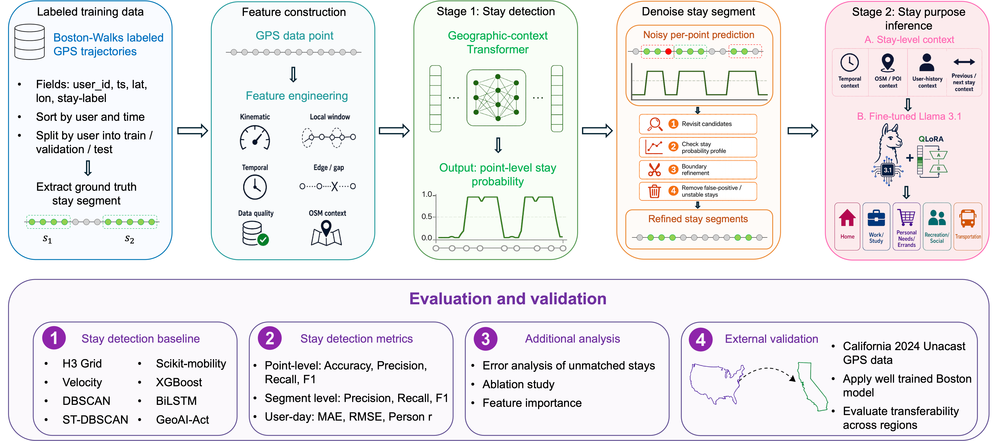
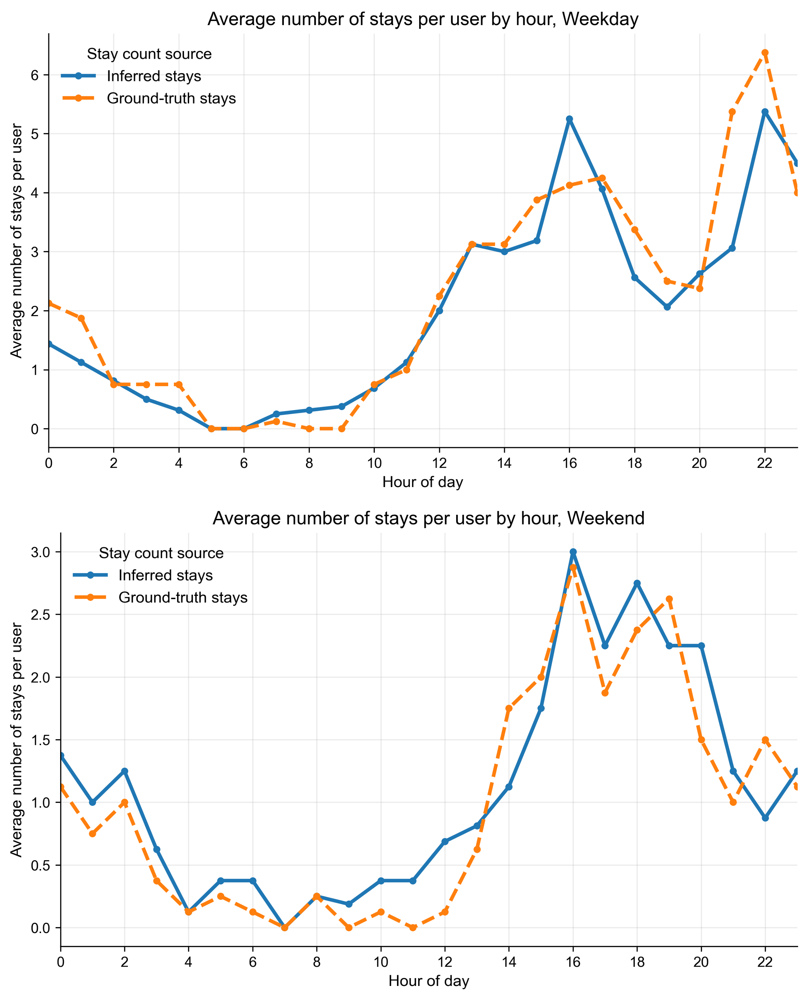
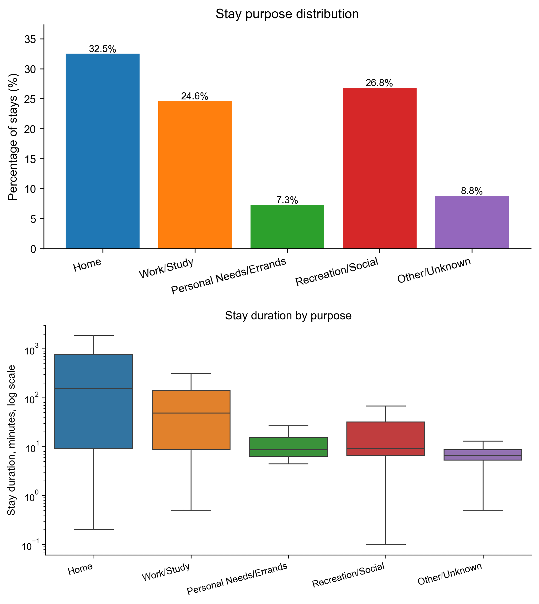

# GeoAI-Act: stay detection and activity-purpose inference

**Status:** accepted full research paper, ACM GeoAI 2026. Read the [accepted author manuscript (ACM GeoAI 2026)](../../manuscripts/geoai-act-accepted-manuscript.pdf). [Assigned DOI](https://doi.org/10.1145/3849726.3856090). This is a selected code showcase, not a complete replication release.

## Research problem and contribution

Travel behavior analysis needs more than a stream of location points: it needs meaningful stops and activity context. This work combines sequence modeling for stay detection with structured spatial, temporal, and personal-history context for activity-purpose inference.

I carried out the hands-on research workflow end to end, including data preparation, model implementation, evaluation, spatial feature construction, experiments, visualization, and manuscript preparation. Coauthor credit remains with the paper; these extracts showcase my implementation.

## Research highlights

The original research combines a geographic-context Transformer for stay detection with a QLoRA-fine-tuned Llama-3.1 model for activity-purpose inference. The manuscript reports these results on the Boston-Walks test set, with users separated across training, validation, and testing:

| Research result | Reported performance |
| --- | --- |
| Stay detection | **0.894 point-level F1** and **0.813 segment-level F1** |
| Activity-purpose inference | **0.808 accuracy** and **0.749 Macro-F1** |
| Value of geographic context | Removing OSM context reduced detection point-level F1 to **0.792** and purpose Macro-F1 to **0.652** |

These are manuscript results (Tables 1, 2, 5, and 6), separate from the synthetic demonstration below. Authors: **Shangkun Jiang, Mustafa Sameen, Ally Recalde, and Xilei Zhao**. All three figures are unchanged original PNGs from the research materials.



**Framework (manuscript Figure 1).** Trajectory features and geographic context feed the stay detector; structured stay-level context feeds the fine-tuned purpose model. Original labels are preserved: the overview uses *Transportation* for the last category, while the results figure uses *Other/Unknown*.



**Comparison with labeled stays (manuscript Figure 5).** Inferred counts preserve broad weekday and weekend patterns, with visible differences at specific hours. This aggregate comparison is a descriptive check, not a classification metric.



**Activity inference (manuscript Figure 3).** Home is the largest inferred category (**32.5%**) and has the longest stays; Recreation/Social (**26.8%**) and Work/Study (**24.6%**) follow. Durations use a logarithmic axis. These shares describe model outputs, rather than population activity rates.

## Code to review

| Source extract | What it demonstrates |
| --- | --- |
| [Sequence model](original/stay_model.py) | Per-user windows, variable-length batch padding and masks, positional encoding, a Transformer classifier, and masked cross-entropy |
| [Stay segments and evaluation](original/stay_segments.py) | Duration and sampling-gap rules, temporal intersection-over-union, and greedy one-to-one matching |
| [Purpose context](original/purpose_payload.py) | Structured context, constrained activity categories, missing-value handling, and separate training/inference messages |
| [Synthetic demonstration](demo/activity_demo.py) | Running the original segment and context functions on invented inputs |

The function and class bodies in `original/` are preserved from the research notebooks. Imports and module documentation were added. The demonstration and checks were added with coding-assistant support during portfolio preparation.

## Run

With Python 3.10 or newer, from this project directory:

```bash
python -m pip install -r requirements.txt
python demo/activity_demo.py
python -m unittest discover -s tests -v
```

The demonstration produces two artificial stay segments, interval matching scores, and a JSON context/message payload. It does not predict an activity purpose or call an external service. The separate model module requires `requirements-model.txt`; no trained weights, GPU, or API access is needed for the demonstration.

## Scope and limitations

The selected model defaults are historical notebook settings, not a claim about the accepted paper's final configuration. Full reproduction also requires authorized trajectories and labels, feature preprocessing, train/validation/test partitions, training and evaluation configurations, and trained artifacts. None of those data or weights are included here.

The manuscript's external California validation used 30 quality-gated users over three days and model-assisted human reference labels. Its results support transfer under those selected conditions; they do not establish generalization to all vendor data or evaluate detection-error propagation through the full purpose-inference pipeline.

The segment functions expect valid timestamps, one consistent user-identifier type, and binary point labels. Supply an explicit empty schema when evaluating empty segment tables. Matching is greedy by IoU, rather than a globally optimal assignment. A stay interval's duration is the difference between its first and last observed point; data gaps and sampling frequency affect this measure. Activity-purpose labels and spatial context introduce further uncertainty.

## Provenance

- `MIT_Stay_algorithm-AllUsers.ipynb`: zero-based cells 47, 49, 50 (model), 84, 87, 88 (segments/evaluation).
- `Stay purpose infer - paper version 6.ipynb`: cells 16–17 (prompts and payload). The original rich-prompt selection is retained.
- Research figures: original GeoAI-Act framework and workshop figure files, matched to Figures 1, 3, and 5 of the accepted author manuscript. Research and figure credit: Jiang, Sameen, Recalde, and Zhao.

No personal trajectories, coordinates from research participants, user identifiers, API keys, notebook outputs, or publisher PDFs are distributed.
