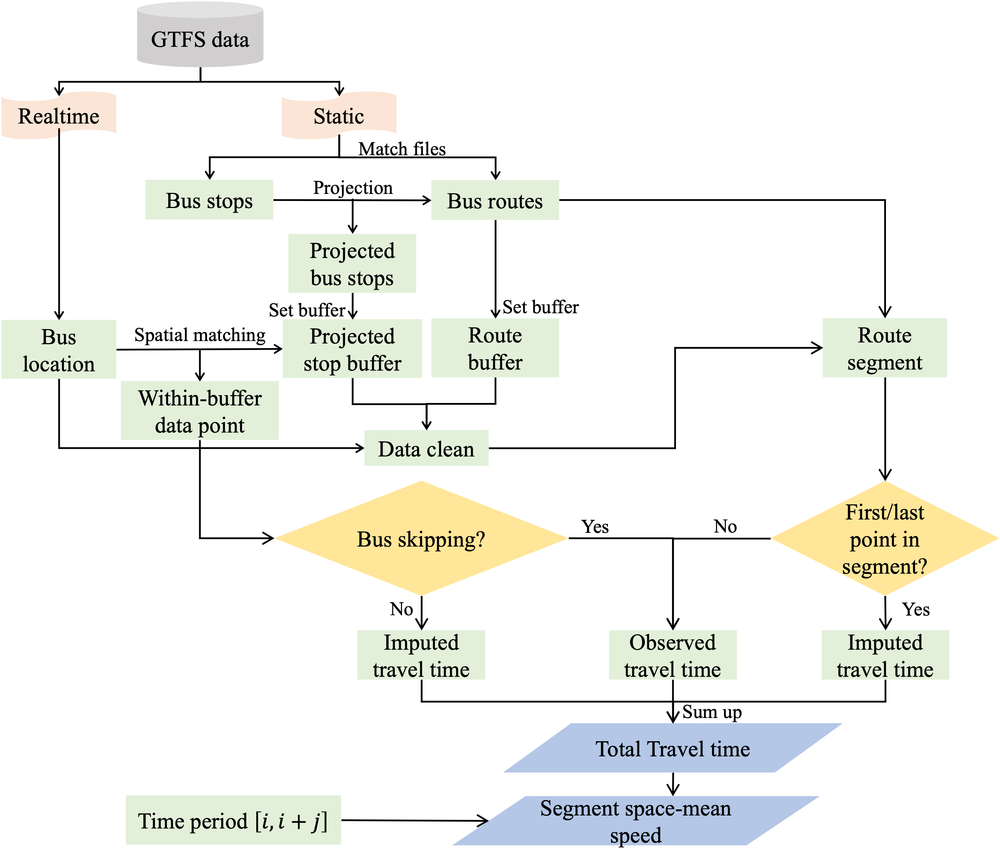
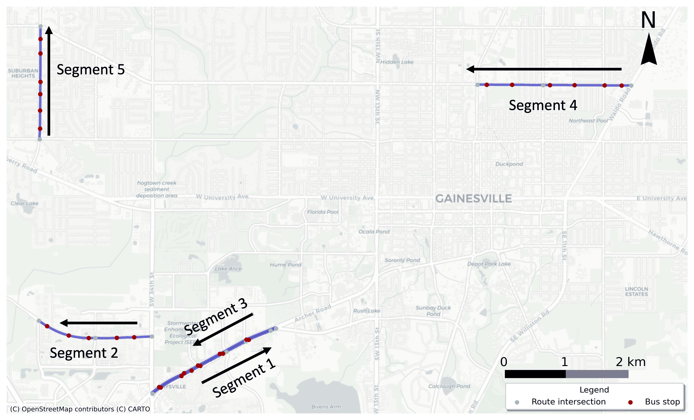
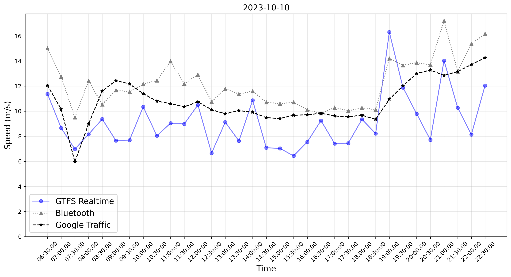

# Traffic monitoring from GTFS Realtime bus trajectories

**Published research:** Shangkun Jiang et al. (2025), Transportation Research Record, 2679(2), 219–236. [Paper DOI](https://doi.org/10.1177/03611981241260708).

## Research problem and contribution

Bus position feeds provide frequent observations on urban roads, but passenger stops make raw bus speed a poor proxy for general traffic speed. This work uses route geometry, stops, intersections, and GTFS Realtime trajectories to estimate road-segment travel times and space-mean speeds, then compares estimates with independent traffic sources in Gainesville, Florida.

I carried out the hands-on workflow end to end: data collection and preparation, geospatial processing, travel-time algorithm implementation, validation, sensitivity analysis, visualization, and manuscript preparation. The paper retains its coauthor credits; these samples focus on my implementation.

## Research highlights

These are original figures from the research, reproduced from the readable PNG versions preserved in the completed dissertation archive. The reported findings use observed study data; the runnable demonstration below uses invented data.

- The Gainesville workflow retained **1,061,207 observations (88.9% of the raw feed)** after preprocessing, with validation spanning five arterial, collector, and local-road segments in October 2023.
- After calibration to Bluetooth travel times using an 80% training / 20% validation split, GTFS-based predictions had **lower RMSE in all five segments** and **lower MAPE in four of five** than the Google Traffic comparison.

**From transit feeds to road-segment speed**

<p align="center"></p>

*Method figure.* Static routes and projected stops define the spatial buffers; Realtime observations supply bus movements. The workflow distinguishes a bus that passes a stop from a bus that dwells, then combines observed and imputed travel times before estimating space-mean speed.

**Validation across different road types**



*Validation setting.* The five corridors cover arterials, collectors, and a local road, with segment lengths of 1.61–2.19 km and speed limits of 35–45 mph. Bluetooth, GTFS Realtime, and Google Traffic observations were aligned to the same segments and observation periods.

**An original three-source comparison**



*Empirical result, Segment 1 on October 10, 2023.* The 30-minute series compare bus-based speed with Bluetooth and Google Traffic speed estimates, showing both within-day variation and the systematic speed gap between buses and general traffic. In the study's separate calibrated travel-time validation for this segment, MAPE was **8.24% for GTFS** and **12.27% for Google Traffic**.

## Code to review

| File | What it demonstrates |
| --- | --- |
| [Spatial processing and travel time](notebooks/01_original_spatial_and_travel_time.ipynb) | Projecting stops/intersections onto routes, splitting segments, selecting complete trips, and calculating three travel-time components |
| [Aggregation and comparisons](notebooks/02_original_aggregation_and_validation.ipynb) | Space-mean speed, comparisons across data sources, and stop-buffer sensitivity |
| [Synthetic demonstration](demo/synthetic_demo.py) | A dependency-free example of the published travel-time equations on an invented straight corridor |

The notebooks are curated original research excerpts. Personal paths and input/output locations were replaced with explicit adapters, outputs were cleared, and cell-level source references were added. They require authorized inputs and are intended for source review. The synthetic example is new code prepared with coding-assistant support for this portfolio.

## Methods

Travel time has three components: observed time outside stop buffers, observed or imputed time across each stop buffer, and interpolation at segment boundaries. The dwell decision compares observed stop crossing with crossing time imputed from adjacent speeds. Space-mean speed is total traversed distance divided by total corrected travel time, rather than an arithmetic average of speeds.

The original excerpt uses a 30 m stop buffer and a strict `> 15 s` dwell rule. The paper describes a 20 m stop buffer and `>= 15 s`; the new demonstration follows the paper's settings. Historical excerpts are therefore not represented as the exact final publication configuration. Distribution comparisons include source mean-shifting; a non-significant KS result is not proof of measurement equivalence or empirical accuracy.

## Run the portable example

From this project directory with Python 3.10 or newer:

```bash
python demo/synthetic_demo.py
python -m unittest discover -s demo -p 'test_*.py' -v
```

The example requires only the standard library. It includes a dwelling bus, a bus passing without dwelling, and an off-route observation. Positions are invented metre coordinates, not real GPS records. It handles one forward segment with one interior stop; the original notebooks show the GIS workflow and multiple stops.

To review/run the notebooks with your own inputs, install `requirements-original.txt` and set `GTFS_DATA_ROOT` to an external data directory. Each notebook describes required files and columns. The selected excerpts retain historical assumptions, segment-specific settings, and exploratory comparisons; validate those settings against new data before using them operationally.

## Data and limitations

Historical GTFS feeds, Bluetooth observations, Google Traffic observations, and comparison workbooks are excluded. The selected original research figures above are included as aggregate results and method illustrations. Full reproduction requires the original data, geometry, collection dates, and complete analysis configuration. Missing observations, stop boundary speeds, incomplete trips, route coverage, CRS choice, and bus-specific behavior can affect estimates.

Original source notebooks: `Code/Travel Time Cal - V2-For use.ipynb` and `Code/SpaceMeanSpeed.ipynb`. The incomplete revision comparison notebook is not included. The portable demonstration does not reproduce the paper's numerical results.
