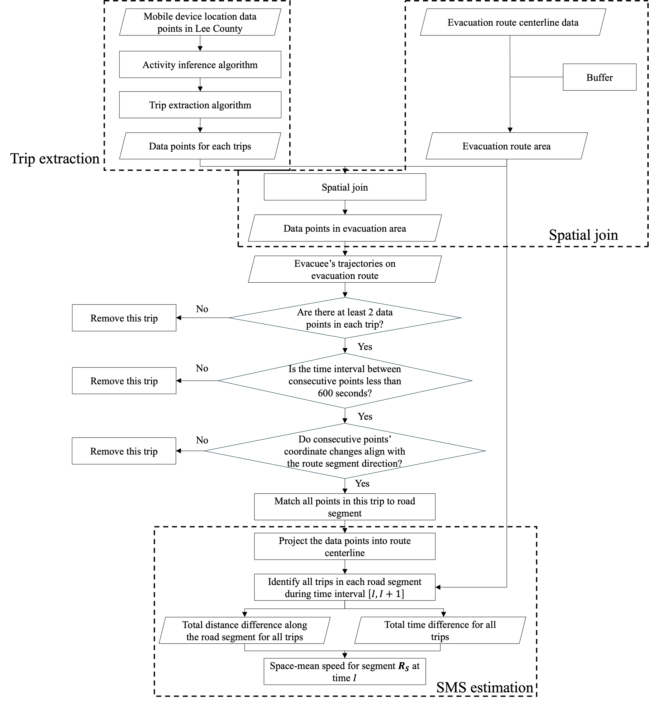
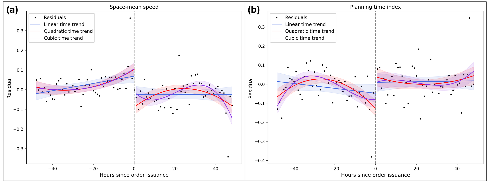
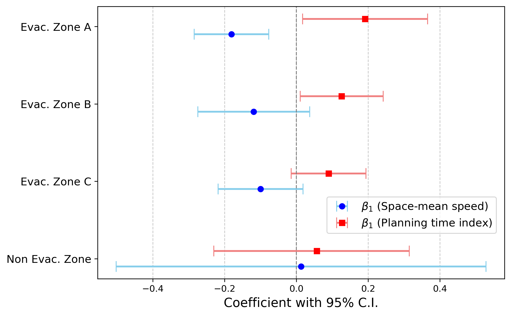

# Hurricane Ian: evacuation orders and traffic performance

This project examines changes in road-segment traffic speed and travel time reliability around the September 27, 2022 evacuation order in Lee County, Florida. It demonstrates transportation data processing, statistical modeling, validation, and sensitivity analysis.

**Publication:** Shangkun Jiang, Xiaojian Zhang, Wai Wong, Sangung Park, and Xilei Zhao. *Examining the short-term impact of evacuation orders on traffic conditions: Evidence from Hurricane Ian.* International Journal of Disaster Risk Reduction, 143 (2026), 106288. [Publication and DOI](https://doi.org/10.1016/j.ijdrr.2026.106288).

**My role:** I am the first author and led the hands-on implementation of the research workflow, including data processing, methodology, software, statistical analysis, validation, visualization, and manuscript preparation. The study was a collaboration with the coauthors listed above; the code samples focus on my implementation work.

## Research highlights

These are original figures from the research, reproduced from the readable PNG versions preserved in the completed dissertation archive. The reported estimates use observed study data; the runnable model demonstration below uses an artificial panel.

- In the baseline RDiT model with **7,139 segment-hour observations**, the September 27, 2022, 7 AM cutoff was associated with **14.9% lower space-mean speed** and **14.6% higher planning time index**. Both baseline coefficients were reported as significant at the 1% level.
- Zone A had the largest zone-specific point estimates: **16.5% lower speed** and **21.1% higher planning time index**. The zone results show why a countywide average can hide concentrated disruptions near the coast.

**From location observations to traffic metrics**

<p align="center"></p>

*Method figure.* The workflow extracts trips, matches them to evacuation-route buffers, and screens their point count, time gaps, and direction. Eligible movements contribute total distance and total travel time to each segment's space-mean speed estimate.

**Traffic changes at the order cutoff**



*Empirical model illustration.* Each point is an hourly aggregated residual after the study's controls and fixed effects; colored curves fit linear, quadratic, and cubic trends separately before and after the order, with 95% confidence bands. The dashed line marks issuance. This diagnostic visualization accompanies the baseline model estimates above; its vertical axes are residuals rather than speed in mph or percentage changes.

**Differences across evacuation zones**



*Empirical heterogeneity result.* Blue circles represent coefficients for log(speed), red squares represent coefficients for log(planning time index), and bars show 95% confidence intervals. Zone A has the largest point estimates in both directions; the non-evacuation area has small estimates and wide intervals. The zone analysis uses the 7 AM cutoff for Zones A and B and the later 2 PM order for Zone C. Coefficients on this axis are converted to percentages with `100 * (exp(beta) - 1)`.

## Analytical workflow

1. Infer trips and identify eligible movement through evacuation-route segments from mobile-device location data.
2. Estimate hourly space-mean speed (SMS) as total distance divided by total travel time. Estimate planning time index (PTI) as the 95th-percentile travel time divided by free-flow travel time, using the segment speed limit as a free-flow-speed proxy.
3. Validate mobile-data speed estimates against traffic detector measurements using aligned observation intervals.
4. Fit regression discontinuity in time (RDiT) models for log(SMS) and log(PTI), with a post-order indicator, a polynomial time trend, weather controls, segment fixed effects, and hour-of-day fixed effects.
5. Examine sensitivity to bandwidths, polynomial orders, alternative cutoffs, and spatial heterogeneity.

The published baseline uses a cubic continuous time trend and a two-day window on each side of the order. The percentage interpretation of a log-outcome discontinuity is `100 * (exp(beta_post) - 1)`.

## Interpretation and limitations

RDiT interpretation depends on the assumption that no unobserved confounder changes discontinuously at the cutoff. Weather controls and fixed effects account for specified observed factors, while sensitivity and placebo checks examine model dependence. These checks do not establish unconditional causal effects. Serial correlation, coincident disaster developments, location-data coverage, and segment aggregation remain relevant limitations.

The original study's validation uses real mobile-device and detector data. Those data are excluded here. Synthetic demonstrations are labeled explicitly and cannot reproduce the published numerical findings or validate real-world measurement accuracy.

## Data boundary

This portfolio contains no raw GPS records, device identifiers, participant records, licensed datasets, credentials, local filesystem paths, or publication PDFs. Original helper functions are provided as source excerpts. Their original data dependencies must be supplied separately to reproduce the empirical study.

## Code and runnable example

| File | Scope |
| --- | --- |
| [Original PTI helper](original/pti_metric.py) | Preserved function body from `Revise_TTR.ipynb`, cell 17 |
| [Original rainfall encoding](original/weather_encoding.py) | Preserved ordinal helper from `Model_data_prepare.ipynb`, cell 26; requires nonmissing strings |
| [Synthetic model demonstration](demo/rdit_demo.py) | New segment-hour panel and baseline model illustration, prepared with coding-assistant support |

The historical PTI helper computes `speed_limit / percentile(speed, 5)`. For a finite sample, quantile interpolation means this need not equal the published travel-time-based definition. The demonstration reports both definitions explicitly. No downstream exploratory outcome rescaling is included, and the excerpts are not certified as the final estimation snapshot.

From this project directory, with Python 3.10 or newer:

```bash
python -m pip install -r requirements.txt
python demo/rdit_demo.py
python -m unittest discover -s tests -v
```

The demonstration uses a continuous cubic trend, weather controls, segment and hour-of-day fixed effects, and a ±48-hour window. Its weather inputs and outcomes are invented. HC1 covariance is a demonstration choice and does not correct serial correlation; it is not a claim about the published inference implementation. The checks verify that the model recovers known discontinuities in an artificial noise-free panel, and that invalid inputs are rejected. They do not verify empirical findings.
