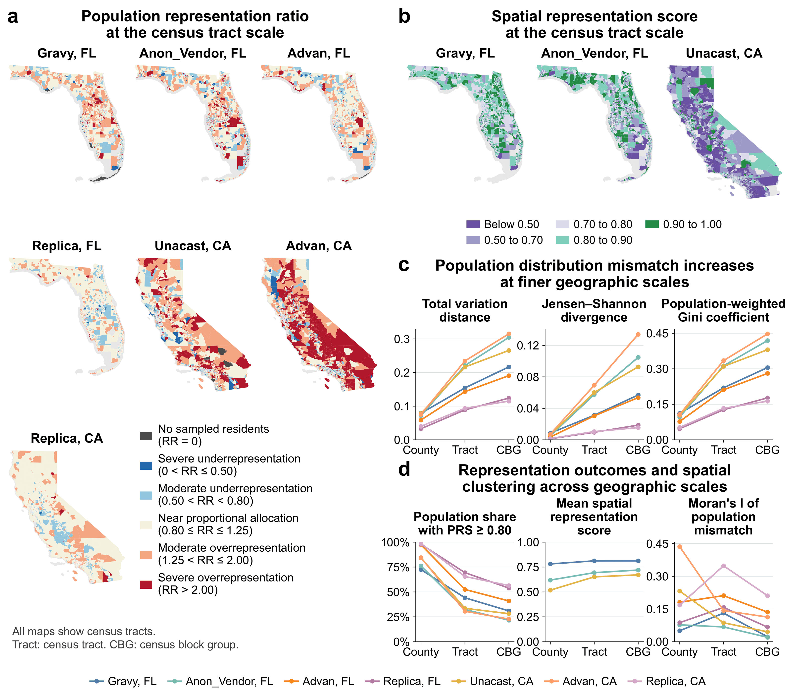
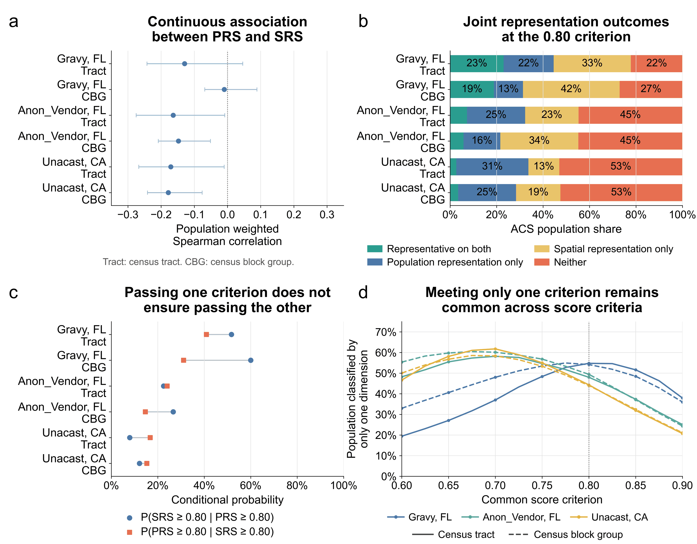
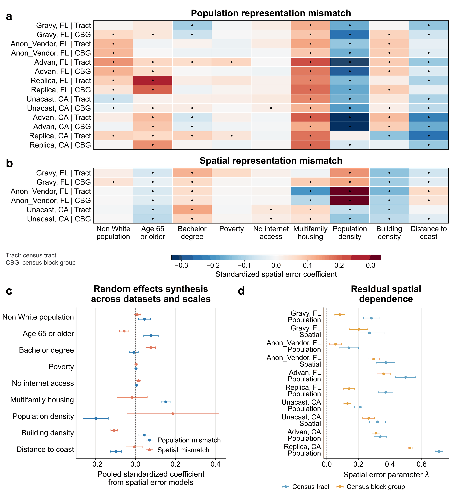

# Spatial representativeness of mobility data

**Status:** submitted manuscript; this portfolio page combines research highlights with methods and code samples. It does not claim a published article or a full replication package. [Read the unpublished author manuscript (portfolio PDF)](../../manuscripts/mobility-bias-author-manuscript.pdf).

## Research problem

A large mobility sample can still misrepresent where people live. This work assesses two dimensions: whether sample counts track population **between geographic areas**, and whether inferred residences resemble residential geography **within an area**. The research compares mobility datasets in Florida and California at county, census tract, and census block group scales.

## Research highlights

These original figures show aggregate empirical results from the **dissertation version** of the study. Population representation (PRS) measures allocation across areas; spatial representation (SRS) compares inferred-home spacing with a residential reference within areas. Five commercial mobility products are evaluated at county, census tract, and census block group scales. The runnable demonstration below uses invented data.

### County agreement can conceal neighborhood mismatch



*Empirical result.* Population distribution mismatch increases from counties to tracts and block groups in **all seven provider–state combinations**. For Gravy in Florida, total variation distance rises from **0.079 at the county scale to 0.217 at the block group scale**. Spatial representation does not follow the same consistent scale pattern. Replica's closer population agreement partly reflects its calibration to Census controls.

### Population and spatial representation identify different areas



*Empirical result.* At the common **0.80 score criterion**, **44.0%–54.8%** of the evaluated ACS population lives in areas meeting only one representation criterion across the six tract and block group comparisons. Population-weighted correlations between PRS and SRS range from **−0.178 to −0.010**. Agreement with population totals therefore does not establish agreement with residential spatial patterns.

### Area characteristics relate differently to the two outcomes



*Empirical result.* Spatial error models show distinct associations across the two dimensions. Building density is positively associated with population mismatch but negatively associated with spatial mismatch in the pooled estimates. Population density is associated with lower population mismatch, while its pooled spatial-mismatch interval includes zero. These are contextual associations, not causal effects.

## My contribution

I carried out the hands-on work end to end: data preparation, residence inference, geospatial processing, metric development, statistical and spatial analysis, validation, visualization, and manuscript preparation. The manuscript retains its coauthor credits; these samples focus on my implementation.

## Code to review

| File | What it demonstrates |
| --- | --- |
| [Original sampling functions](original/sampling_representation.py) | Sampling rates and population-normalized relative representation |
| [Original spatial functions](original/spatial_representativeness.py) | Average k-nearest-neighbor distances, area-weighted residential sampling, and Monte Carlo comparison |
| [Runnable synthetic demonstration](demo/representation_demo.py) | Small, deterministic examples of both dimensions, without restricted data |

The first two files contain selected function bodies from the original notebooks. The demonstration is a new, simplified example prepared for this portfolio and is clearly separated from the research code.

## Methods in the preserved code

- Sampling rate: `SR_i = sample_i / population_i`.
- Relative representation: `RR_i = (sample_i / total_sample) / (population_i / total_population)`. `RR = 1` indicates proportional coverage; values above or below 1 indicate overrepresentation or underrepresentation.
- Historical notebook within-area score: `M_i = exp(-abs(r_i / h_i - 1))`, where `r_i` is the observed average k-nearest-neighbor distance and `h_i` is its simulated residential reference. Scores are averaged over reference draws. `M = 1` indicates matching distance scales, which does not prove demographic representativeness. This selected notebook score is distinct from the manuscript/dissertation SRS specification used in the research figures.
- The wider analysis examines spatial scale, sampling intensity, sociodemographic associations, and residual spatial dependence. The selected functions illustrate the metric layer rather than the complete modeling workflow.

## Run the demonstration

From this project directory with Python 3.10 or newer:

```bash
python -m pip install -r requirements.txt
python demo/representation_demo.py
python -m unittest discover -s tests -v
```

All inputs are invented in the demonstration. It prints metrics for four artificial districts and compares uniformly distributed and clustered point patterns in an artificial square. It performs no downloads and reads no research files.

To use the original spatial functions with your own authorized data, also install `requirements-original-spatial.txt`. Supply GeoDataFrames in a suitable projected coordinate reference system. They require valid, positive-area residential polygons and more than `k` points. The historical notebook default of two simulations is exploratory; select and document adequate Monte Carlo draws for a new analysis.

## Data access and limitations

Original commercial mobility records, inferred device residences, and provider-derived tables are omitted. The author manuscript and aggregate research figures provide context for the code. Reproducing the study requires authorized provider data, Census population/geographic inputs, residential-area geometry, and the remaining processing and modeling stages. Provider terms and access conditions apply independently of this code.

Coverage does not establish that devices correspond one-to-one with residents. Residence inference, provider sampling, geographic aggregation, the residential reference distribution, and `k` can affect results. The portable demonstration uses dense NumPy distances and a simple square reference; original functions use scikit-learn and residential polygons. Neither the toy output nor these extracts reproduce manuscript results.

## Provenance

The research figures are unmodified author-source PNGs from dissertation Chapter 5; captions and observations are condensed from that chapter's figure captions and results. The downloadable PDF was compiled from the latest supplied `PNAS_Main.zip` scientific source. Template author placeholders were replaced with the exact author, affiliation, and contribution information in the same-title August 2026 source manuscript; scientific text and figures were retained. This is an unpublished author manuscript, not a publisher version of record.

The original extracts come from `3_Code/SR_RR_Bias.ipynb` (sampling-rate and relative-representation functions) and `3_Code/Representativenss metric.ipynb` (within-area metric functions). Notebook paths, execution state, saved outputs, and data are excluded. Function bodies are preserved; imports and documentation were made explicit. The synthetic demonstration and its checks were added during portfolio preparation with coding-assistant support.
