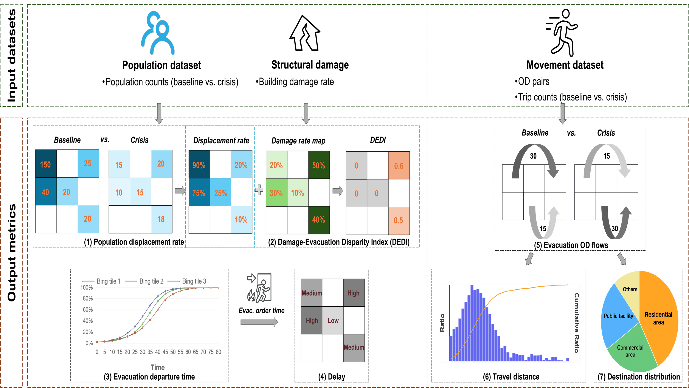
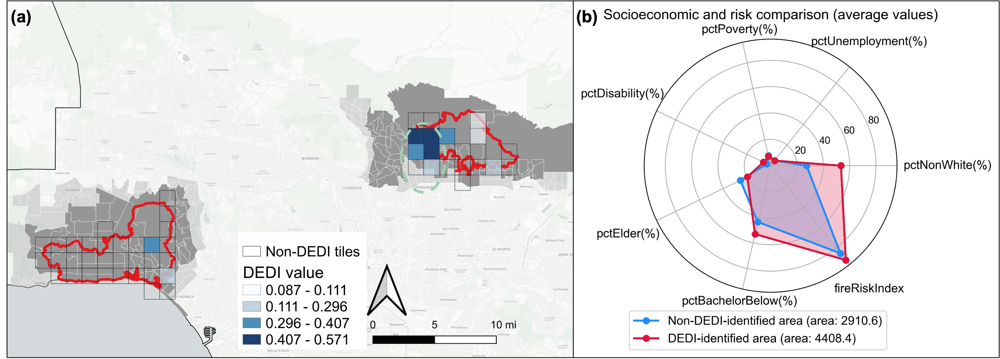
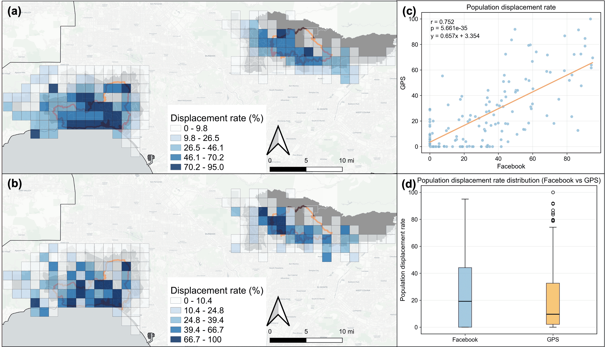

# Wildfire evacuation: Palisades and Eaton fires

**Published research:** Shangkun Jiang et al. (2026), *Wildfire evacuation analysis using facebook data: Evidence from Palisades and Eaton fires*, Transportation Research Part D, 158, 105456. [Read the article](https://doi.org/10.1016/j.trd.2026.105456).

## Research problem

Emergency planners need to understand how population displacement, departure patterns, and destinations vary across fire-affected communities. This study develops an integrated framework using Facebook population and movement aggregates during the 2025 Palisades and Eaton fires, combines structural damage with displacement, and cross-checks selected patterns with an independent GPS dataset.

## Research highlights

These original figures are from the dissertation version of the published study. The framework is a method schematic; the maps and comparison panels report aggregate empirical results. The runnable examples later on this page use invented inputs.

### From population and movement data to evacuation metrics



*Method schematic.* Baseline and crisis population counts produce displacement and departure metrics; structural damage adds the Damage-Evacuation Disparity Index (DEDI). Movement aggregates support OD, distance, and destination analysis. Values inside this diagram illustrate the calculations.

### Where structural damage exceeded population displacement



*Empirical result.* Higher DEDI values mark a larger gap between structural damage and population displacement. High values concentrate around the Eaton Fire, including West Altadena. The accompanying comparison shows higher average non-White population share, lower educational attainment, and higher wildfire risk in DEDI-identified areas. The study reports a positive association with the Social Vulnerability Index (**r = 0.563, p < 0.01**); DEDI describes an area-level mismatch rather than individual intent.

### Independent GPS data show similar displacement patterns



*External comparison.* Facebook and independent GPS estimates show similar spatial patterns and a positive tile-level correlation (**r = 0.752, p < 0.001**). Facebook estimates are slightly higher on average. This comparison supports the aggregate displacement pattern while showing that the two sources do not yield identical rates.

## My contribution

I carried out the hands-on work end to end: data collection and preparation, geospatial processing, methodology implementation, software, analysis, validation, visualization, and manuscript preparation. The published paper retains its coauthor credits. Its contribution statement specifically credits me with software, methodology, data curation, formal analysis, validation, visualization, investigation, conceptualization, and writing.

## Original research code

These excerpts preserve four original function bodies from my research notebooks, with explicit imports and source references added. Notebook execution state, research data and top-level file-loading calls are excluded. All cell indices below are zero-based.

| Source sample | Original notebook and cells | What to review |
| --- | --- | --- |
| [Population preprocessing and metrics](original/population_metrics.py) | `1_Population (paper).ipynb`, 19 and 23 | Tile-date completion, sequential missing-count imputation, evacuation/influx percentages and signed population change |
| [OD geometry](original/od_geometry.py) | `2_Movement (paper).ipynb`, 109 | Aggregate repeated OD pairs, join endpoint coordinates, construct and project LineStrings |
| [Demographic overlay](original/demographic_overlay.py) | `1_Population (paper).ipynb`, 37 | Intersect square buffers with demographic polygons and calculate feature-specific area-weighted means |

[The original-source illustration](demo/original_source_example.py) calls these preserved functions on small invented tables and polygons. It lets a reviewer inspect their behavior without research data; its fixtures and checks were newly prepared for the portfolio.

### Run the original excerpts on invented inputs

From this project directory, using Python 3.10 or newer:

```bash
python -m pip install -r requirements.txt -r requirements-original-spatial.txt
python demo/original_source_example.py
python -m unittest discover -s tests -p test_original_source.py -v
```

### Source assumptions

- Population inputs use `quadkey`, `ds`, `n_baseline` and `n_crisis`. Evacuation rate is a nonnegative percentage, from 0 to 100 for nonnegative crisis counts and positive baselines. Influx can exceed 100%, and `percentage_change` is signed. The original function does not validate zero baselines.
- Imputation expects one row per tile/date, numeric count columns and chronologically sortable dates; it neither aggregates nor validates duplicates. It uses dates available somewhere in the input, rather than generating a calendar. Missing values in the first three positions use up to three future valid values; later positions use the preceding three positions, including earlier imputations. It processes tiles with missing dates and does not clean every missing value in an otherwise complete tile.
- OD inputs require start/end quadkeys, latitude/longitude and baseline/crisis counts. A quadkey must have one consistent coordinate pair; inconsistent coordinates can duplicate rows during joins. The geometry connects endpoints and does not reconstruct traveled routes.
- Overlay inputs require WGS84 latitude/longitude, a consistent coordinate pair per quadkey, the 14 demographic columns listed in the function and polygons already in EPSG:3857. `buffer_size` is a **half-width**, so the default produces a square 2,446 projected units wide. Web Mercator distances and areas are projection dependent. Missing feature values are excluded and the remaining intersection areas are renormalized for each feature. Unmatched tiles retain missing feature values.
- Area-weighted `totalPopulation` is an average of polygon values, not a population count within the square. Income is an average of source polygon medians, not the square's median; the original function converts the `250,000+` category to 250,000. These preserved functions require further validation before application to new data.

The selected Population notebook is the source for these excerpts. Other notebook versions contain different preprocessing assumptions; they are not mixed into this sample. These functions are selected original source, rather than a verified snapshot of the complete final analysis.

## Separate published-methods demonstration

[The synthetic demonstration](demo/evacuation_metrics_demo.py) implements selected published equations using small invented tile-time and OD tables. It is a newly prepared example for this portfolio, not the original research notebook or a reproduction of the article's results.

| Component | Method shown |
| --- | --- |
| Population displacement | `P = (crisis - baseline) / baseline`; `E = max(-P, 0)` |
| Departure curve | `F = max(baseline - crisis, 0)`; `C(t) = 100 * cumulative_sum(F) / total_sum(F)` within each tile |
| Damage-Evacuation Disparity Index | `DEDI = max(0, D - E) / (1 - D)`, with `0 <= D < 1` |
| Evacuation-related OD selection | Origin in an evacuation/warning zone; destination outside the zone or in another zone farther from the fire |

Population deficits can include the same absent population in successive time slices. The cumulative curve follows the article's aggregate metric; it is not a cumulative count of distinct people departing. DEDI identifies an aggregate damage-response mismatch and does not establish voluntary noncompliance or individual behavior. Geometry-based zone membership and distance from the fire are provided as prepared inputs in this small example.

### Run the published-methods demonstration

From this project directory with Python 3.10 or newer:

```bash
python -m pip install -r requirements.txt
python demo/evacuation_metrics_demo.py
python -m unittest discover -s tests -v
```

Both examples read no external files, perform no downloads, and use no real Facebook or GPS observations. All counts, locations, zone labels, and dates are invented. The separate published-methods demonstration rejects missing/invalid counts and duplicate tile-time keys instead of silently imputing them. Undefined cumulative departure shares and zero-baseline OD changes remain missing. Original-function behavior is documented above and kept distinct from this newer demonstration.

## Data and full-study requirements

The published article states that the authors do not have permission to share the data. No Facebook population or movement records, GPS observations, derived restricted tables, or publisher PDF are distributed here. Reproducing the study requires authorized data access, preprocessing and privacy-suppression handling, evacuation-zone/time layers, fire perimeters, CAL FIRE structural damage data, land-use inputs, and the complete original analysis workflow.

The research uses approximately 2.4 km grid cells and 8-hour temporal intervals. Suppression, noise, spatial smoothing, missing data, platform selection, geographic aggregation, and destination land-use approximation affect interpretation. Population decline is an evacuation-related proxy; it does not identify every resident's decision. These limitations are central to using the metrics for planning.

## Provenance

The research figures are unmodified author-source PNGs from dissertation Chapter 3; their captions and observations are condensed from the original figure captions and accompanying results. The original excerpts come from the named notebook cells; their function definitions were checked against the source. Imports, example fixtures, behavior checks and documentation were added with coding-assistant support. The separate `evacuation_metrics_demo.py` was prepared from the published methodology, specifically Sections 3.1–3.3 and Eqs. (1)–(5). The paper's full coauthor list and source are available through the DOI above. Neither example reproduces the published empirical outputs.
